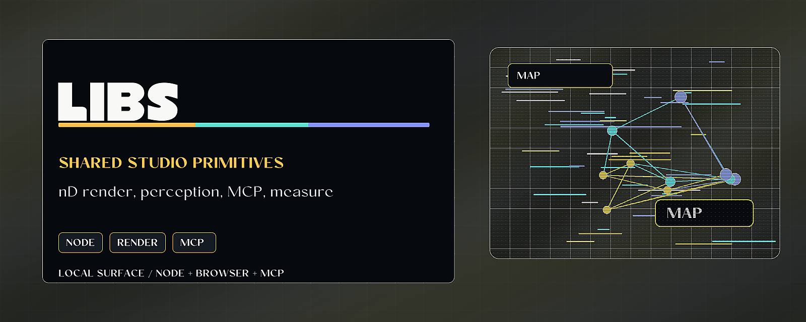

# studio-libs



> Shared Studio primitives for nD rendering, perception readouts, MCP, and measurement.

studio-libs is a local collection of zero-dependency libraries that feed the
Project Telos Studio work: n-dimensional rendering, layered perception readouts,
and a native MCP server for perceive/render/measure loops with receipt-backed
measurement boundaries.

## Why it matters

The Studio needs reusable primitives below the website layer. Keeping these
libraries separate makes it easier to test rendering, perception, and measurement
behavior before those capabilities are composed into the larger engine.

## Try it

```bash
git clone <local-or-future-remote> studio-libs
cd studio-libs
npm test
node studio-perception-mcp/server.mjs --help
```

## What to test first

- Inspect `render-nd` for geometry, rotation, projection, and raster paths.
- Inspect `sense-core` for layered perception readouts.
- Inspect `studio-perception-mcp` before wiring MCP clients.

## Current status

Local library workspace with no remote configured in this checkout. Treat it as a
revival and integration source for the Studio engine rather than a packaged npm
release.

## License

Check package-level licenses before extracting individual libraries.

## Existing technical notes

Zero-dependency perception + nD rendering libraries, and a native MCP organ that exposes them.

- **render-nd** — isomorphic nD geometry/rotation/projection + raster (node) and WebGL (browser) backends.
- **sense-core** — the lossless layered perception readout (criterion-parity with the live web Studio's eye).
- **studio-perception-mcp** — a Node-stdlib MCP server: perceive · render · measure + a live resource.

**Honest boundary:** native, lossless, persistent, near-ambient perception — NOT weights-level ambient.
When a tool fires is the client's decision, not the server's.

## For developers

Keep the public README, examples, and repository metadata aligned with current behavior. Before opening a PR or publishing a release, verify the working tree and any documented commands for this repo.

```bash
git status --short
```
