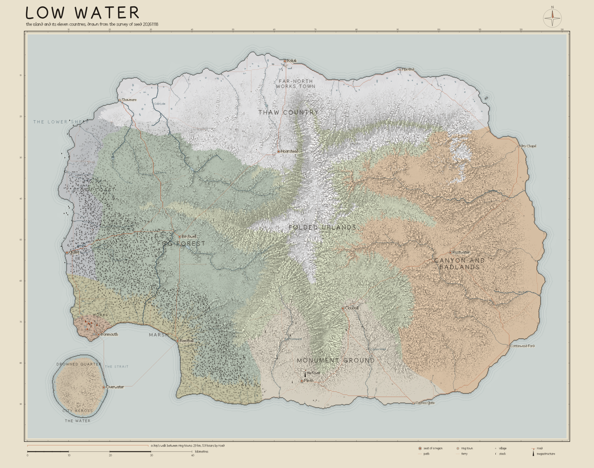

# The world

Low Water as one continuous island, generated from a seed. The island measures 131 km by 98 km on a grid of 2048 by 1536 cells, 64 m to a cell. It holds eleven regions, a river system, lakes, fifteen ring towns a day's walk apart, forty-six villages, the roads between them and the landmarks that give each region its skyline.

The canonical seed is `20261118`.

The world bible is `WORLD.md`: every region with its geography, climate, light, architecture, people, creatures and the saved images it traces to. `stills/README.md` shows each region and says plainly which look right.

## Make a world

The generator is BuildLang (`gen/`). Build it with buildc 1.15.0 or later, then run it with a seed and an output folder.

```bash
buildc build --release games/low-water/world/gen
mkdir -p games/low-water/world/out/20261118
games/low-water/world/gen/target/release/main 20261118 games/low-water/world/out/20261118
```

A run takes about 30 seconds on one core and prints the time of each stage.

## What it writes

| File | Holds |
|---|---|
| `height.pgm` | ground height, 16 codes to the metre, code = (metres + 512) x 16 |
| `water.pgm` | water surface in the same code, 0 where the ground is dry |
| `river.pgm` | river class, 8 x sqrt(drainage in km2), 0 where there is no river |
| `moist.pgm` | rain share, 0 to 255 |
| `biome.pgm` | ground cover, 0 to 13 (the list is in `gen/climate.bld`) |
| `region.pgm` | region, 1 to 11, spread over the sea so weather has no hole |
| `world.json` | regions, settlements, roads with walking hours, river lines, landmarks, checks |

The rasters are plain PGM text. buildc's file writer takes strings and a string cannot hold a zero byte, so a binary raster is a compiler gap, recorded here as language debt. `pgm.mjs` reads them in node and in the browser.

## Walk it

```bash
node games/low-water/game/serve.mjs
```

Open `http://127.0.0.1:8731/world/walk/index.html` in a browser with WebGPU. W A S D move, the mouse looks after a click, Shift runs, F flies, Space and C rise and sink. The number keys, 0 and minus go to the eleven regions. The wheel turns the clock and T holds it.

The page draws four passes on the engine's web GPU host (`native/web/raw-gpu.mjs`): sky, ground, masses and water.

- **Ground.** CDLOD on a quadtree from 32.8 km nodes to 128 m, vertices 4 m apart under the walker. The 64 m raster carries the land; a lattice noise adds relief 16 m and 4 m across, and the walker's feet compute the same function.
- **Water.** One surface for the sea, the lakes and the rivers, with depth colour, a wind-driven swell, foam at the shore and lamp streaks near towns.
- **The kit of parts** (`walk/build/parts.mjs`). Windows, doors, lanterns turned on a lathe, signs with lettering drawn from a seed, chimneys, clutter (air conditioners, potted plants, bicycles, crates, vending machines, heaps of shovelled snow), cables across lanes, and people as small figures with coats and umbrellas. Each region builds from the same parts in its own vernacular (`VERNACULAR`: snow, coast, marsh). The snow town of Thaw Country is built from it.
- **Masses.** Instanced trees and grass round the walker, and placeholder architecture from `world.json` at three scales: houses and ring walls, monuments, megastructures.
- **Sky.** Sun, moon, stars, the Milky Way, a cloud layer with storm cells, a 22 degree halo, aurora and a comet.
- **Weather and time** (`weather.mjs`). A day weighted toward dusk, night and dawn, one signature weather for each region with gradient borders, and sky events by rule from the seed.

Stills and frame times come from `tools/shot.mjs`, which drives a headless browser on the CPU adapter by default.

```bash
node games/low-water/world/tools/shot.mjs --out stills --views all
```

## The plate

```bash
node games/low-water/world/plate/plate.mjs --out plate.svg
```

The same files drawn as a hachured map: shadow hachures lit from the north-west, water-lining round the coast, rivers that widen to the sea, tree, reed and stipple signs by cover, the roads and the ferry in one accent colour, and every name lettered from the game's own stroke skeletons (`game/engine/ui/lettering`). The scale bar carries the measured day's walk between ring towns. `plate/low-water-20261118.png` is the plate of the canonical seed.



## How the island is made

1. **Tectonic sketch** (`tect.bld`). Five plates, each a handful of seeds moved by the world seed. Where two plates meet the ground lifts: the long north-south range stands on the boundary of the west foreland and the east block. The south-west plate sinks and becomes the delta. A city island stands across a strait from the bay.
2. **Erosion** (`erode.bld`, `flood.bld`). Thirty rounds of stream-power erosion against uplift. Each round floods the surface from the sea inward, which gives every cell a downhill way out, then cuts each cell toward its receiver in proportion to the square root of its drainage.
3. **Water** (`hydro.bld`). Four overdeepened valley reaches become long lakes. Kettle ponds open on the northern shield and pools in the marsh. A last flood finds every basin and its spill level.
4. **Climate** (`climate.bld`). Temperature falls to the north and with height. Rain arrives on a west wind and is spent on the climb, so the east block sits in a rain shadow.
5. **Cover and regions** (`climate.bld`, `stages.bld`). Cover follows temperature, rain, slope and height. Regions follow plate, height and shore.
6. **Settlements and roads** (`settle.bld`, `roads.bld`). One seat for each region that can hold one, then ring towns where the nearest is too far, villages, and lone houses on the high moor. Roads are least-time routes under Tobler's hiking function.
7. **Landmarks** (`landmarks.bld`). Vernacular, monument and megastructure masses placed by rule, up to the 1,200 m Tower of the monument ground.

Every step uses integer hashing and the operations `+ - * / sqrt floor` only, the rule of `design/DETMATH.md`, so a seed gives the same bytes on any machine.

## Checks

```bash
BUILDC=buildc node --test games/low-water/world/tests/world.test.mjs
```

- **Determinism.** Two runs of one seed give byte-identical files. A second seed gives a different terrain.
- **Hydrology.** Along every river line the water surface never rises, and the line ends in the sea, in a lake or on another line that does. The control builds the same world with one river bed raised 40 m; the generator's own check and the file check must both fail on it.
- **Scale.** The test prints the walking time of every road between ring towns. For seed 20261118 the median is 5.9 hours over 29 km, the shortest 2.3 hours with the ferry and the longest 12.0 hours.
- **Regions.** All eleven exist, each with its seat and its landmark kinds.

## Language

The generator is BuildLang. The raster reader and the checks are JavaScript modules run by node, the form every other Low Water test takes. The debt: binary output from BuildLang, and the checks themselves, which could move once buildc can read a file of this size quickly.
