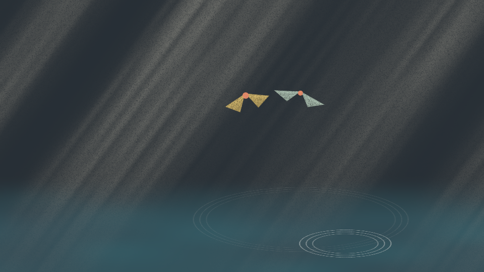

# Samara

A thirty-second piece of visual music. Two maple seeds, each a pair of triangles hinged at a
rust-red nut, spin down through shafts of light to dark water.



The whole piece is one BuildLang file, `main.bld`: the score, the synthesiser, the animation, the
renderer and its own checks.

```
buildc build --release pieces/samara
cd somewhere-with-room && path/to/pieces/samara/target/release/main
```

It writes `samara.wav` (48 kHz, 16-bit stereo) and `samara.rgb` (raw 24-bit frames, 24 a second,
1.1 GB at 960 x 540) into the folder it runs in. Any encoder that reads raw video joins them:

```
ffmpeg -f rawvideo -pix_fmt rgb24 -s 960x540 -r 24 -i samara.rgb -i samara.wav -c:v libx264 -crf 16 -pix_fmt yuv420p -c:a aac samara.mp4
```

For another size, change the one `render_frames(s, 960, 540, 0, 720, 1)` line at the end of
`main.bld`. Everything is drawn in units of the frame height, so the picture is the same at any size.

## One schedule

A single table of 75 notes drives the sound and the picture, so a note and the motion it causes
cannot drift apart.

| Voice | Sound | Picture |
|---|---|---|
| the gold seed (22 notes) | a struck bar, six partials | each note turns the seed and lifts it a little |
| the green seed (22 notes) | the same, a fourth or so lower, answering | the same, for the second seed |
| drops (10 notes) | a low tone whose pitch falls onto the note | a pale stroke falls for half a second, then three rings spread |
| the pad (20 notes) | detuned sines, slow in and out | how bright the shafts of light are |
| the gust (1 note, beat 32) | noise through an opening filter | the light flares and leaves cross the frame |

The seeds land on beats 36 and 38. Those two landings are drops in the score, so they ring the
water like any other drop.

## How it looks the way it does

- Chalk on black paper: every lit thing is multiplied by a paper-tooth noise with dark specks.
- One hue family (slate blue to teal) with two pale wings and one warm accent, the nut.
- A seed turning about its own axis is drawn by squeezing its width with the cosine of the turn;
  the underside is darker.
- Shapes are signed-distance triangles and rings, so edges are smooth at any size.

## Checks the program runs on itself

It prints these every run:

```
seed notes 44 | at written pitch 44 | starting on the written sample 44
planted sharp note caught 1 of 1
gold notes 22 | seed turns within two frames of the note 22
```

- Pitch: each seed note is rendered alone and its written frequency must carry at least four
  times the power of the semitone above and below.
- Onset: silence in the 96 samples before the written start, sound in the 96 after.
- Planted fault: a note rendered a semitone sharp must fail the pitch check.
- Sync: the turn that a gold note gives the seed has risen two frames after the note.

## Verified

- Checked: the three printed lines above. By: the program, on a full run with buildc 1.10.0 on
  Windows. Result: as shown.
- Checked: the picture. By: looking at frames from three renders. Result: the first render drew
  the seeds as solid squares and washed the frame grey; both were fixed, as was a striped grain.
- Not checked: how it sounds. The tone and balance have been measured for pitch and timing only,
  and nobody has listened to it yet. Other compiler versions and machines are also untested.

## Credit

The method (picture made from the music, simple shapes carrying a character, one hue family with
one accent, black as a colour) is learned from Fantasia and Fantasia 2000. The design, the score
and the code are ours.
